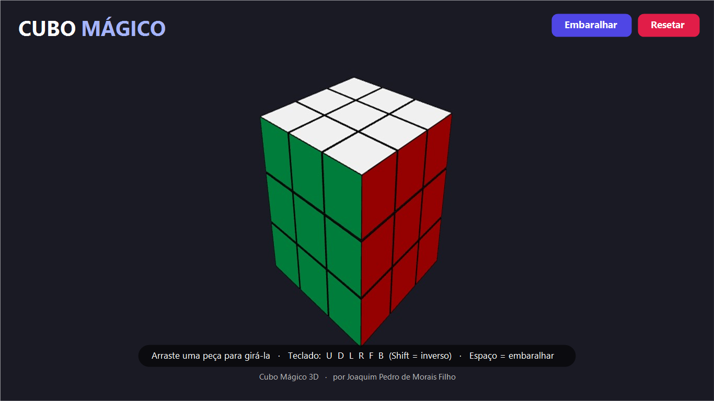

<div align="center">

# 🧩 Cubo Mágico 3D

### O clássico cubo mágico, em 3D, para Windows — gire com o mouse ou o teclado, embaralhe e resolva.

**Por Joaquim Pedro de Morais Filho · j360074@hotmail.com**



<br>

[**▶ Jogar no navegador**](https://elevbit-ai.github.io/cubo-magico/play/) ·
[**⬇ Baixar para Windows**](https://github.com/elevbit-ai/cubo-magico/releases/latest) ·
[**🛒 Microsoft Store**](https://apps.microsoft.com/detail/9NCBF09M4M0S) ·
[**🌐 Site**](https://elevbit-ai.github.io/cubo-magico/)

</div>

---

## O que é

Um **cubo mágico 3×3 totalmente interativo em 3D**. Gire as camadas arrastando as peças,
orbite a câmera para ver o cubo de todos os ângulos, embaralhe e tente resolver — no seu ritmo.

A versão para Windows é um **app nativo** (um pequeno `.exe` que hospeda o jogo via
Microsoft Edge **WebView2**), com o motor 3D ([Three.js](https://threejs.org)) **embutido no
pacote**: roda **100% local**, sem internet, sem anúncios, sem cadastro e sem coletar dados.

## Recursos

- 🧊 Cubo mágico **3×3 em 3D de verdade**, com animação suave
- 🖱️ **Mouse:** arraste uma peça para girar a camada · arraste o fundo para orbitar a câmera · scroll para zoom
- ⌨️ **Teclado:** notação **`U` `D` `L` `R` `F` `B`** (com **Shift** = movimento inverso) · **Espaço** = embaralhar
- 🔀 Botões **Embaralhar** e **Resetar**
- 🔒 **Privado e offline** — nada sai do seu computador
- 🪟 **Nativo para Windows** (MSIX) e também **jogável no navegador**

## Como jogar

| Ação | Mouse | Teclado |
|------|-------|---------|
| Girar uma camada | Arraste uma peça na direção do giro | `U` `D` `L` `R` `F` `B` (Shift = inverso) |
| Girar a câmera | Arraste o fundo | — |
| Zoom | Scroll do mouse | — |
| Embaralhar | Botão **Embaralhar** | `Espaço` |
| Resetar | Botão **Resetar** | — |

> `U`=cima, `D`=baixo, `L`=esquerda, `R`=direita, `F`=frente, `B`=trás (notação padrão do cubo).

## Instalar / executar

- **Microsoft Store** (recomendado): [apps.microsoft.com/detail/9NCBF09M4M0S](https://apps.microsoft.com/detail/9NCBF09M4M0S)
- **Portátil:** baixe o `CuboMagico3D-portable-win-x64.zip` na
  [release](https://github.com/elevbit-ai/cubo-magico/releases/latest), extraia e dê dois cliques em `CuboMagico3D.exe`.
  Requer o [Microsoft Edge WebView2 Runtime](https://developer.microsoft.com/microsoft-edge/webview2/)
  (já incluso no Windows 11 e na maioria dos Windows 10).
- **No navegador:** [elevbit-ai.github.io/cubo-magico/play](https://elevbit-ai.github.io/cubo-magico/play/)

## Compilar do código

Requisitos: Windows com o **.NET Framework** (já vem no Windows). Para gerar o MSIX, o **Windows 10/11 SDK**.

```powershell
# compila o CuboMagico3D.exe (baixa as DLLs do WebView2 automaticamente) e, se o SDK existir, gera o MSIX
powershell -ExecutionPolicy Bypass -File build.ps1
```

## Como funciona

```
CuboMagico3D.exe (C#/WinForms)  →  WebView2  →  web/index.html (HTML + WebGL/Three.js)
```

O app é um host nativo mínimo que cria uma janela com um controle **WebView2** e carrega o
jogo a partir de uma pasta local do próprio pacote (mapeada por um *virtual host*). Todo o
3D roda localmente no WebGL; nenhum recurso é buscado na internet.

## Estrutura

```
CubeHost.cs            host nativo C#/WinForms (WebView2)
web/                   o jogo: index.html + Three.js embutido (lib/)
msix/AppxManifest.xml  manifesto do pacote MSIX
Assets/                ícones e tiles
docs/                  site (GitHub Pages) + versão jogável (docs/play/)
build.ps1              compila e empacota
```

## Autor e licença

**Joaquim Pedro de Morais Filho** · j360074@hotmail.com — [MIT](LICENSE)
